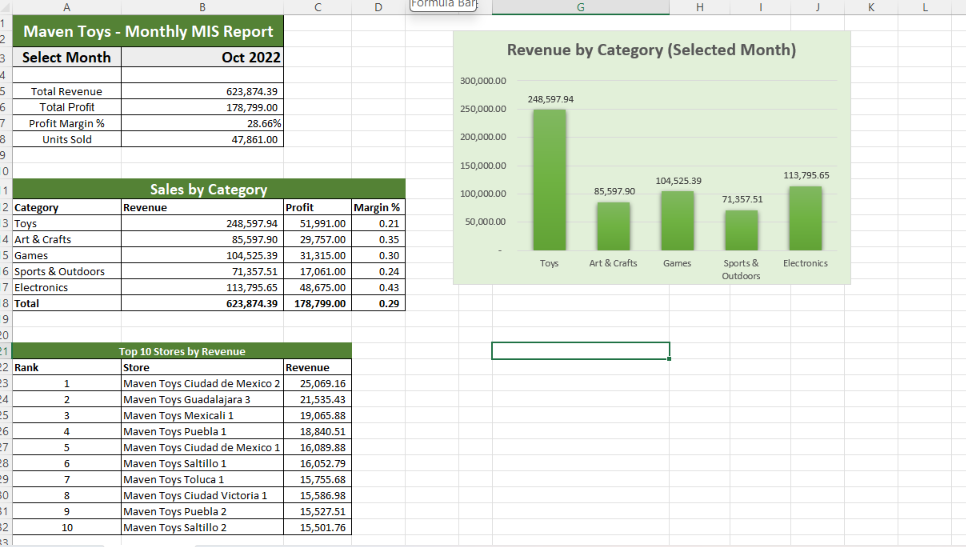
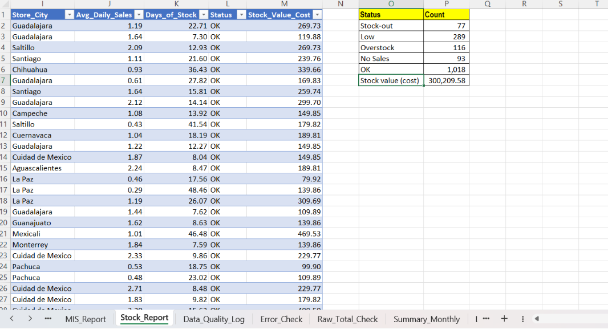
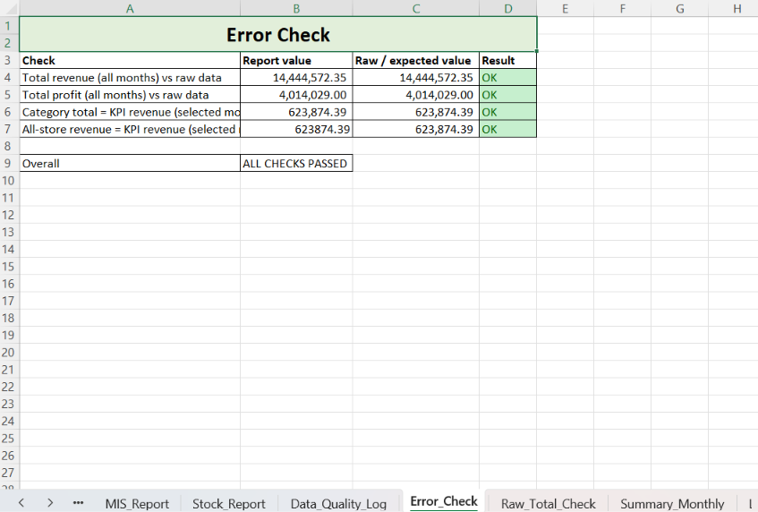
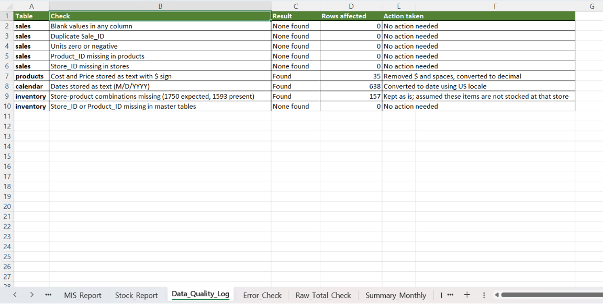

# Maven Toys: Monthly MIS Report and Stock Report (Excel)

## Business question
Which stores and products are losing sales because of low stock, and where is money stuck in overstock? The report also gives a monthly view of revenue, profit and category sales.

## Data
Maven Toys Sales and Inventory data from Maven Analytics (a fictional chain of toy stores in Mexico). Source: https://mavenanalytics.io/data-playground/mexico-toy-sales
- 829,262 sales records, 1 Jan 2022 to 30 Sep 2023
- 35 products, 50 stores, 1,593 inventory rows (a single snapshot with no date)

This is a practice dataset, not company data.

## What is in the workbook
| Sheet | Purpose |
|---|---|
| Instructions | How to use and refresh the report |
| MIS_Report | Month drop-down, KPIs, category sales, top 10 stores and a chart |
| Stock_Report | Stock status for every store and product |
| Error_Check | Matches report totals with raw data totals |
| Data_Quality_Log | Data checks done and what was fixed |
| Raw_Total_Check, Summary_Monthly, Lists | Helper sheets used by the report |

## How I built it
- Loaded 5 CSV files with Power Query and kept them in the Excel Data Model (the sales file is too big for a normal sheet).
- Cleaned price columns stored as text and fixed calendar dates.
- Joined sales with products and stores, then added Revenue, Cost and Profit columns.
- Built a monthly summary table and used SUMIFS with a month drop-down for the report.
- Built the stock report from the last 90 days of sales: average daily sales, days of stock left, and a status for each store and product.
- Checked totals with a PivotTable and an Error_Check sheet.

## Results
- Total revenue 14,444,572.35 and total profit 4,014,029 (revenue is units multiplied by retail price).
- Highest month: Dec 2022.
- Stock status (last 90 days, 3 Jul to 30 Sep 2023): 77 store-product combinations are out of stock but were selling, 289 have less than 7 days of stock, 116 have more than 90 days of stock, and 93 have stock but no sales. Stock value at cost is about 300,210.

## Data quality notes
- No duplicates, blanks, negative units or missing IDs were found.
- Price columns (35 rows) and calendar dates (638 rows) were stored as text and converted.
- 157 store-product combinations are missing from inventory. I assumed those items are not stocked at that store.

## Limits
- Fictional data, so findings are practice only.
- Inventory is one snapshot, so the stock report depends on the 90-day window I chose.
- Data refresh works only on my computer because the queries point to my local CSV files. The report itself opens and works anywhere.

## Download the Excel file
Open the **Releases** section on the right side of this page and download `MIS_Project.xlsx`. Open it in Microsoft Excel and click Enable Editing. GitHub cannot open Excel files in the browser.

## Screenshots
### MIS report (month drop-down, KPIs, category sales, top 10 stores, chart)

### Stock report (stock status for every store and product)

### Error check (report totals match raw data)

### Data quality log

Built by Suraj Kumar Pandey
